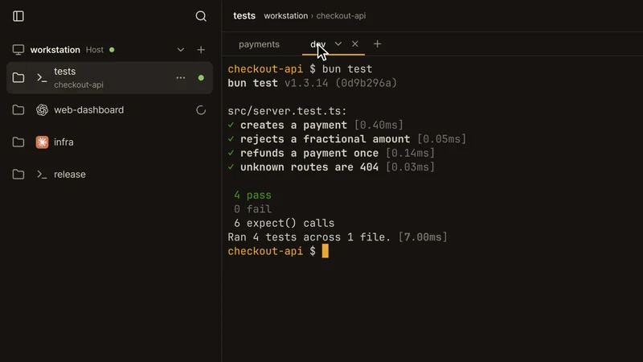
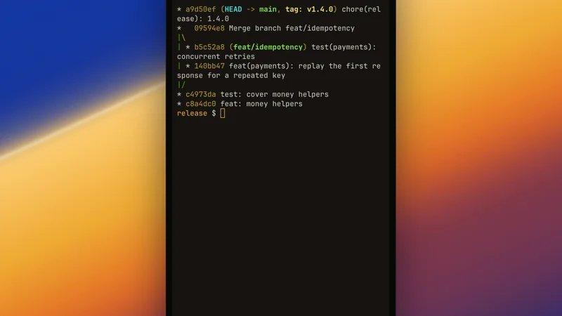
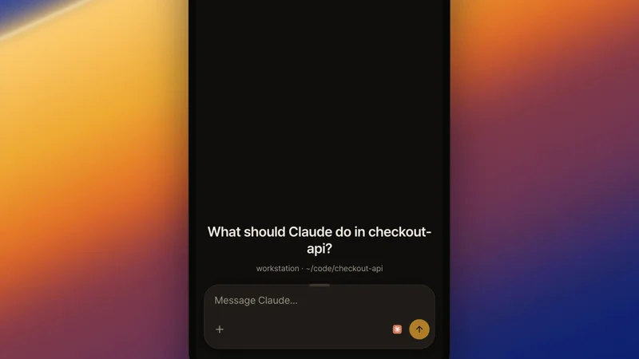
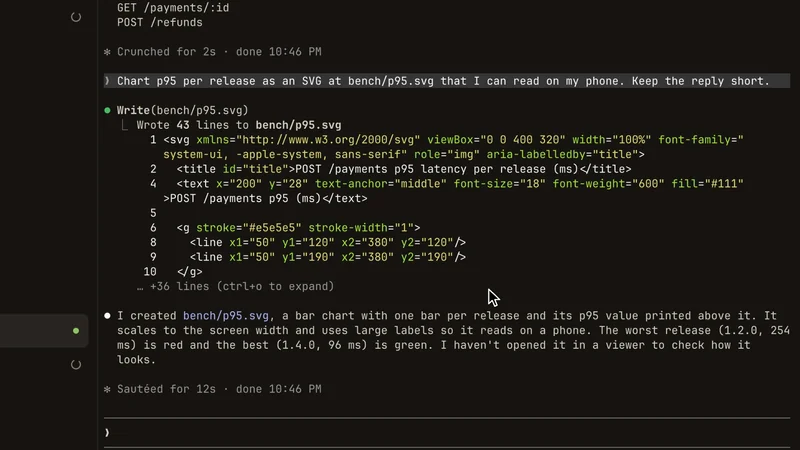
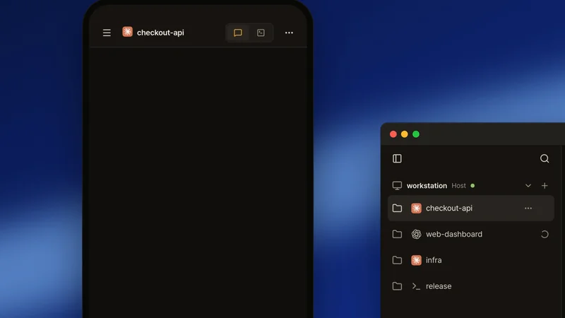

# herdr web ui

<p align="center">
  
</p>

<p align="center">
  <a href="README.md">English</a> · <a href="README.zh-CN.md">简体中文</a> · <a href="README.ja.md">日本語</a> · <a href="README.ko.md">한국어</a> · <strong>Türkçe</strong>
</p>

<p align="center">
  <a href="https://herdrweb.dev/">web sitesi</a> ·
  <a href="#kurulum">kurulum</a> ·
  <a href="https://herdrweb.dev/demo/">demoyu dene</a> ·
  <a href="docs/guide.md#quick-start">hızlı başlangıç</a> ·
  <a href="#sss">sss</a> ·
  <a href="#dokümanlar">dokümanlar</a>
</p>

<p align="center">
  <a href="LICENSE"></a>
  <a href="https://github.com/devswha/herdr-web-ui/stargazers"></a>
  <a href="https://github.com/devswha/herdr-web-ui/releases/latest"></a>
  <a href="https://github.com/herdrdev/herdr"></a>
  <a href="docs/guide.md#on-your-phone"></a>
</p>

---

https://github.com/user-attachments/assets/d854dbb6-64bd-4eba-81c7-fbd3f525726b

<p align="center"><sub>Tek bir Claude Code oturumu: önce herdr'ın terminalinde, sonra tarayıcının Terminal ve Sohbet görünümlerinde, en sonda telefonda — yanında yeni bir worktree açılır · canlı kayıt, kesmesiz</sub></p>

**Claude Code ve Codex, telefonunuzdan.**

[herdr](https://github.com/herdrdev/herdr) için tarayıcı ve telefon istemcisi. Bilgisayarınızda çalışan aynı ajan oturumlarını okuyun ve yanıtlayın — masaüstünde veya telefonda, sohbet olarak; gerektiğinde terminaliyle birlikte.

<table>
  <tr>
    <td width="50%" valign="top">
      <a href="https://github.com/user-attachments/assets/32ca9aa4-960f-4629-9fb5-17c12ba35c80"></a>
      <br><b>Canlı terminale geçin</b>
      <br><sub>Tek tıkla sohbet, panelin gerçek terminaline dönüşür; telefonda tuş çubuğundaki ↑ test komutunu geri getirir, yanındaki Enter onu yeniden çalıştırır.</sub>
    </td>
    <td width="50%" valign="top">
      <a href="https://github.com/user-attachments/assets/22d10639-9aa6-4953-a5f3-a1b743f4053b"></a>
      <br><b>herdr düzeniniz, tarayıcıda</b>
      <br><sub>Her çalışma alanı, sekme ve bölünmüş panel, her ajanın durumuyla birlikte: bir sekmeye tıklayın, bölünmenin bir panelini seçin ya da çalışma alanlarına telefondan geçin.</sub>
    </td>
  </tr>
  <tr>
    <td width="50%" valign="top">
      <a href="https://github.com/user-attachments/assets/b228a2b8-6db5-4546-a15b-972056000cab"></a>
      <br><b>Bir ajanın size ihtiyacı olduğunu bilin</b>
      <br><sub>Başka bir çalışma alanındayken Claude bir şey sorduğunda uyarı iner; tek dokunuş sorusunu açar.</sub>
    </td>
    <td width="50%" valign="top">
      <a href="https://github.com/user-attachments/assets/a193b426-259c-47d9-bd73-10acc2594265"></a>
      <br><b>Telefondan ekran görüntüsü gönderin</b>
      <br><sub>+ düğmesi görüntüyü panelin klasörüne yükler ve yolunu ekler; Claude görüntüyü okur.</sub>
    </td>
  </tr>
  <tr>
    <td width="50%" valign="top">
      <a href="https://github.com/user-attachments/assets/bc419d3e-ebda-4fb5-acc5-e498609559fe"></a>
      <br><b>Ajanın ürettiğini açın</b>
      <br><sub>Terminaldeki bir yola tıklayın ya da sohbette dokunun: dosya hemen orada açılır.</sub>
    </td>
    <td width="50%" valign="top">
      <a href="https://github.com/user-attachments/assets/150a4c9d-7667-4f63-ba56-8f91e6a25878"></a>
      <br><b>İkinci bir ajan dallandırın</b>
      <br><sub>Telefondan ⋯ → Yeni worktree: dal doldurulmuş olur, bir ajan seçersiniz ve ilk ajanın yanında başlar.</sub>
    </td>
  </tr>
</table>

<p align="center"><sub>Her kare, masaüstü ve bir telefonun aynı anda gerçek zamanlı kaydıdır; kesmesiz. Tam video için birine tıklayın.</sub></p>

- **Sohbet ve terminal, tek panelde** — yerel Claude Code, Codex, omp, omo, gjc, pi, Hermes ve açıkça tanımlanmış Devin CLI dökümleri, ayrıca herdr'ın tanıdığı OpenCode 2 oturumları; canlı terminal bir tık uzağınızda. Ajan çalışırken sıradaki mesajı yazın: sıradaki turla birlikte girer ya da Şimdi gönder ile hemen. [Desteklenen ajanlar →](docs/guide.md#supported-agents)
- **Tek dokunuşla onaylayın** — onaylar, sorular ve plan menüleri karta dönüşür; yanıtınız gönderilmeden güncel oldukları denetlenir.
- **Ne zaman gerekli olduğunuzu bilin** — her panel için canlı durum, uygulama açıkken gelen uyarılar ve bir ajan girdi istediğinde ya da bittiğinde, uygulama kapalıyken bile anlık uyarılar.
- **Telefonunuza kurun** — klavyenin üzerinde yeniden düzenlenebilen ve Ayarlar'da kendi bileşimlerinizle genişletilebilen tuş çubuğu (Esc, Tab, Ctrl, Alt, Shift, Enter, yön tuşları) olan bir PWA ve Tailscale adresinize QR kodu. [Telefon kurulumu →](docs/guide.md#on-your-phone)
- **Yazmak yerine konuşun** — sohbete ya da terminal satırına dikte edin, Korece ve İngilizce karışık. Sözcükleri ajana göndermeden önce inceleyin; yazıya çevirme kendi OpenAI anahtarınızı ya da tarayıcının konuşma tanımasını kullanır.
- **İş akışınızı koruyun** — ajanların sahibi herdr'dır; bu uygulama onlara bağlanır. Ayarlar'dan, onları durdurmadan güncelleyin; her güncellemenin getirdikleri not olarak gelir. Yeni sekmeler ve worktree'ler satırın ⋯ menüsünden gelir. [Tüm özellikler →](docs/guide.md#features)

---

## kurulum

```bash
curl -fsSL https://herdrweb.dev/install.sh | sh
```

Linux (x64, arm64) veya macOS. Eksik herdr 0.9.0+, Bun 1.4+ ve Node 18+ önkoşullarını kullanıcınız için kurar, sonra uygulamayı bir herdr eklentisi olarak kurar. Var olan herdr kurulumu 0.9.0'dan eskiyse, kurulumu yeniden çalıştırmadan önce herdr'ı kendiniz güncelleyip yeniden başlatın. Varsayılan dinleme adresiyle ve Tailscale çalışırken, başarılı HTTPS kurulumu bir tailnet adresi ve QR kodu sağlar. Kendi cihazlarınız kodsuz girer: `tailscale serve` oturumunuzu belirtir. Kendi telefonunuz yine de eşleştirme istenirse, `HERDR_WEB_TAILSCALE_SERVE_ONLY=1` tek oturumun sahibi olduğu bir tailnet'te kodsuz girişe izin verir — ama yalnızca başka hiçbir şey (ör. genel bir proxy veya tünel) bu porta erişmiyorsa ([Erişim ve güvenlik](docs/guide.md#access-and-safety)).

Windows x64, PowerShell'de:

```powershell
irm https://herdrweb.dev/install.ps1 | iex
```

[Git for Windows](https://git-scm.com/download/win) gerektirir. Eksik herdr ve Bun'ı kullanıcınız için kurar, sonra aynı eklentiyi kurar. Node ya da WSL gerekmez. Telefon erişimi için herdr içinde **Telefon kurulumu**'nu açın. Windows terminalleri, herdr orada terminal bağlamayı destekleyene dek [ekran aynasını](docs/remote-pcs.md#windows-pcs) kullanır: yazma ve sabit ızgara ile.

<p align="center">
  
</p>

Önkoşullarınız zaten var mı? Yalnızca eklentiyi kurun:

```bash
herdr plugin install devswha/herdr-web-ui
```

herdr çalışırken **[localhost:7317](http://localhost:7317)** adresini açın. Bir panel seçin ya da **Yeni çalışma alanı** ile bir ajan başlatın. Telefonunuzu kullanmak için kurulumun QR kodunu okutun ve uygulamayı ana ekranınıza ekleyin. [Hızlı başlangıç →](docs/guide.md#quick-start)

Sunucu varsayılan olarak `127.0.0.1` üzerinde dinler. Başka bir cihazdan erişim için [telefon kurulumu](docs/guide.md#on-your-phone) ve [erişim ve güvenlik](docs/guide.md#access-and-safety) bölümlerine bakın.

## sss

**Claude Code'u ya da Codex'i telefonumdan kullanabilir miyim?**

Evet. Ajanı bilgisayarınızdaki bir [herdr](https://github.com/herdrdev/herdr) panelinde çalıştırın; bu uygulama aynı paneli telefonunuzun tarayıcısında gösterir: ajanın kendi dökümü sohbet olarak, onayları ve soruları dokunduğunuz kartlar olarak, canlı terminal bir dokunuş uzağınızda. PWA olarak ana ekrana kurulur ve bir ajan size ihtiyaç duyduğunda anlık uyarı gönderir. [Telefon kurulumu →](docs/guide.md#on-your-phone)

**Sohbet görünümü hangi ajanları destekliyor?**

Claude Code, Codex, omp, omo, gjc, pi ve Hermes kendi oturum depolarından okunur. OpenCode 2 için sohbet, herdr'ın OpenCode'un veritabanından bildirdiği oturumu okur; ana ekran ve OpenCode 1.x bunun yerine canlı terminali kullanır. Devin CLI, herdr ya da çalışan süreç oturumunu adlandırdığında (`devin --resume <id>` gibi) sohbettir; düz bir `devin` canlı terminali gösterir. herdr panelindeki diğer her program canlı terminali ve durumunu alır. [Desteklenen ajanlar →](docs/guide.md#supported-agents)

**herdr'ın kendi TUI'sının yerini alır mı?**

Hayır. İkisi de aynı terminallere aynı anda bağlanır; panel masanızda, tarayıcıda ve telefonda canlı kalır. Hiçbir şey durmaz ya da devredilmez. [TUI ve tarayıcı →](docs/guide.md#faq)

**Tailscale gerekir mi?**

Hayır. Tailscale, bir SSH tüneli, bir VPN ya da kendi HTTPS proxy'niz bilgisayara bir yol sağlayabilir. Kurulum ve anlık uyarılar HTTPS ya da localhost gibi güvenli bir bağlam gerektirir; temel gezinme LAN üzerinde düz HTTP ile de çalışır. [Seçenekler →](docs/guide.md#faq)

**Kodum ya da konuşmam makinemden çıkar mı?**

Oturum dosyaları her ajanı çalıştıran bilgisayarda kalır; içerikleri yalnızca bağlanan tarayıcılara sunulur. Uygulamanın kendi barındırılan aktarıcısı ya da hesap servisi yoktur. İsteğe bağlı ses girdisi, sesi (ve düzeltirken metni) yapılandırılan sağlayıcıya gönderir; etkinleştirilen kullanım göstergeleri sağlayıcı API'lerine bağlanır. Güncellemeler, uzak bilgisayar kurulumu ve anlık uyarılar da dış servisleri kullanabilir. Uygulama kurulduğunda ve her güncellendiğinde anonim bir sayaç gönderir (sürüm, işletim sistemi, nasıl kurulduğu ve rastgele bir kimlik; IP adresi saklanmaz); **Ayarlar → Hakkında → Anonim kullanım sayaçları** ne gönderildiğini gösterir ve kapatır. Ajanların kendi model bağlantıları yapılandırmalarına bağlıdır. [Veri akışı ve erişim →](docs/guide.md#faq)

**Windows'ta çalışır mı?**

Evet, WSL olmadan Windows x64 üzerinde. herdr orada terminale bağlanmayı destekleyene dek terminal, yazma ve sabit ızgaralı bir [ekran aynasıdır](docs/remote-pcs.md#windows-pcs).

**collie, roamgate ya da herdr-remote'dan farkı ne?**

Bunlar da herdr için telefon ya da tarayıcı istemcileri. Bu uygulama ajanın kendi dökümünü okur; böylece panel, terminal çıktısı yerine tur başına katlanmış iş içeren bir sohbettir ve diğer bilgisayarlar kenar çubuğundan SSH ile katılır. Tünel getirmez ve yalnızca herdr'ı yönetir: tmux ya da zellij, diff'ler, Telegram ya da kutudan çıkan bir tünel istiyorsanız, diğerlerinden biri daha uygun olabilir. [Tam karşılaştırma →](docs/guide.md#faq)

**Happy, Paseo ya da CloudCLI UI'dan farkı ne?**

O projeler ajan oturumları başlatmanın ya da yönetmenin kendi yollarını sunar. Bu uygulama zaten çalıştırdığınız herdr panelleriyle çalışır ve aynı terminalleri TUI'da ve tarayıcıda kullanılabilir tutar. herdr kullanmıyorsanız o projelerin kurulum seçeneklerini ve ajan desteğini karşılaştırın. [Tam karşılaştırma →](docs/guide.md#faq)

## dokümanlar

[Kullanıcı kılavuzuyla](docs/guide.md) başlayın: [hızlı başlangıç](docs/guide.md#quick-start) · [desteklenen ajanlar](docs/guide.md#supported-agents) · [özellikler](docs/guide.md#features) · [telefon](docs/guide.md#on-your-phone) · [uzak bilgisayarlar](docs/remote-pcs.md) · [erişim ve güvenlik](docs/guide.md#access-and-safety) · [yapılandırma](docs/guide.md#configuration) · [klavye kısayolları](docs/guide.md#keyboard-shortcuts) · [SSS](docs/guide.md#faq).

Daha yakından bakmak için: [nasıl çalışır](docs/guide.md#how-it-works) · [sohbet dökümleri](docs/chat-mode-audit.md) · [terminal akış denetimi](docs/terminal-flow-control.md) · [uygulama güncellemeleri](docs/app-updates.md) · [değişiklik günlüğü](CHANGELOG.md).

## teşekkürler

[herdr](https://github.com/herdrdev/herdr) üzerine kurulmuştur; ilham [chatmux](https://github.com/devswha/chatmux)'tan; gücünü [xterm.js](https://xtermjs.org), [React](https://react.dev), [Bun](https://bun.sh) ve [Lucide](https://lucide.dev)'den alır.

Katkıda bulunan herkese teşekkürler.

## ajan yönergeleri

Birine uygulama kurduruyor musunuz? [INSTALL.md](INSTALL.md)'yi izleyin. Depo değişiklikleri için [CONTRIBUTING.md](CONTRIBUTING.md), [inceleme kuralları](.github/REVIEW.md) ve [AGENTS.md](AGENTS.md) geçerlidir.

## geliştirme

```bash
git clone https://github.com/devswha/herdr-web-ui.git
cd herdr-web-ui
bun install

bun run server      # API + WebSocket, :7317
bun run dev         # Vite, :5173; ikinci bir terminalde çalıştırın
```

```bash
bun run typecheck
bun run test:unit   # herdr gerekmez
bun test           # yalıtılmış herdr test oturumu
bun run test:ui    # tarayıcı regresyon denetimleri
```

Değişiklik göndermek için [CONTRIBUTING.md](CONTRIBUTING.md), testler/medya/sürümler için [geliştirme](docs/development.md), arayüz kuralları için [DESIGN.md](DESIGN.md). Güvenlik sorunlarını özel olarak bildirin: [SECURITY.md](SECURITY.md).

## lisans

[MIT](LICENSE). Copyright © 2026 devswha.
